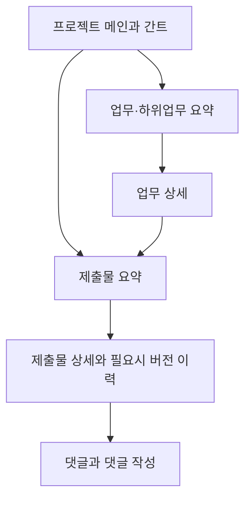

# WBSCowork 구조와 결정

이 문서는 **왜 그렇게 정했고 경계가 어떻게 연결되는가**를 소유한다. 위치는 [PROJECT_MAP](PROJECT_MAP.md), 현재 상태는 [TODO](TODO.md), 검증 방법/결과는 [HARNESS_MAP](HARNESS_MAP.md), 운영은 [NAS_UPDATE_GUIDE](NAS_UPDATE_GUIDE.md)를 본다.

## 1. 시스템 경계

WBSCowork는 Next.js 16 App Router 단일 애플리케이션이다. UI, Server Components, Server Actions, Route Handlers가 같은 배포 단위에서 동작한다. Node 실행은 MariaDB 및 로컬/NAS 파일 저장소를, Sites 실행은 Vinext/Workers + D1/SQLite + 비공개 R2를 사용한다. Google NextAuth와 FSD 경계는 동일하다.

Sites의 실행 계약은 아래에, 검증 기준선은 HARNESS_MAP, 게시 이력은 COMPLETED_LOG에 둔다. MariaDB/파일 경로 설명은 Node 실행 경로다.

```text
Browser
  ├─ React 19 + MUI + frappe-gantt client leaf
  └─ Next.js navigation/forms/download
        ↓
Root app/ adapters (page/layout/action/route)
        ↓
src/widgets/features/entities/shared public API
        ├─ MariaDB
        ├─ UPLOAD_DIR
        └─ LOG_DIR
```

별도 REST API 계층은 없다. Node의 node:test 하네스를 유지하며 Sites는 Drizzle schema/migration과 Miniflare/workerd 검증을 추가한다. 애플리케이션 질의는 작은 prepared-query adapter를 통한다. Sites 런타임에서는 DDL이나 .env 편집을 실행하지 않는다.

### Sites 저장 경계

- `sites/worker.ts` → request-scoped `hosted-runtime` → D1/R2 bindings.
- DB parent/attachment 변경 및 task 계층 갱신은 atomic batch를 사용한다.
- R2 객체는 인증된 제출물/버그 download handler로만 읽으며 공개 URL을 제공하지 않는다.
- cascade/교체/중단 업로드는 durable cleanup ledger와 지연 재시도로 정리한다.
- 감사 상세는 D1의 제한된 보존 정책, console은 비민감 요약이다. 감사 저장 장애 시 상세 기록을 보장하지 않는 best-effort 정책을 명시한다.
- 앱의 superuser 설정 화면은 배포 설정 유무만 표시한다. 실제 secret 및 SUPERUSER_EMAIL은 소유자의 Sites 설정에서 관리한다.

## 2. Next.js 렌더링과 조립

- `app/layout.tsx`: global CSS, frappe-gantt CSS, provider와 `AppShell` 조립. runtime 인증 상태를 빌드 시 익명 cache로 고정하지 않도록 force-dynamic으로 처리하며 공개 경로의 익명 접근은 유지한다.
- `app/page.tsx`: 로그인 전 readiness 안내; 로그인 후 선택 프로젝트 Gantt/태스크 요약.
- `app/privacy/page.tsx`: 로그인 없이 접근 가능한 개인정보 처리·보유·프로젝트 종료 파기 안내.
- `app/tasks/page.tsx`: `dynamic = "force-dynamic"`; 세션과 DB readiness 확인 후 workspace 조립.
- 관리자 page도 서버에서 권한을 검사한다. 민감 route는 UI 메뉴 노출과 독립적으로 fail closed해야 한다.
- 동적 params/searchParams는 Next.js 16 패턴에 맞게 Promise를 await한다.
- 브라우저 API가 필요한 Gantt/focus/provider/UI leaf만 client component로 둔다.

## 3. 인증·인가

### 인증

`src/entities/user/api/auth.server.ts`가 NextAuth v4 설정의 단일 중심이다.

1. Google OAuth가 설정된 경우 provider 활성화.
2. sign-in callback이 DB user를 sync하고 action log 기록.
3. JWT callback이 email, DB role, env 기반 `isSuperuser`를 넣음.
4. session callback이 이를 `session.user`에 노출.

슈퍼관리자는 별도 DB role이 아니라 검증된 로그인 이메일과 현재 `SUPERUSER_EMAIL`의 일치로 판정한다. JWT/session callback과 `getAuthSession`이 현재 설정으로 effective admin/SU 표시를 다시 계산하므로 오래된 DB role·session flag가 SU를 강등하지 않는다. DB row의 role은 `admin|member|guest`이며 이 보강이 기존 row를 강제 승급하는 것은 아니다.

### 권한 정책

- 전역 관리: 현재 DB 사용자와 설정된 SU identity를 다시 검사한다. 프로젝트 생성·다중 소속/접근 정책, 사용자/역할·버그 검토, DB/log/settings는 SU 전용이다. 본인의 버그 작성/열람은 기존 모든 역할에 유지한다.
- 프로젝트 관리: SU 또는 현재 `admin`이면서 해당 프로젝트의 활성 `project_members`인 사용자다. 기존 인증 읽기 허용 프로젝트에서도 미지정 admin의 관리/private 전체 열람은 허용하지 않는다.
- 읽기: `legacy_authenticated`는 기존 인증 읽기를 유지한다. `members_only`는 SU/활성 프로젝트 소속만 허용하고 자원 visibility/ownership을 추가 적용한다. 계정 역할·프로젝트 소속·팀장 역할은 서로 별개다.
- 쓰기: 기존 role helper는 후보만 판정한다. 프로젝트 접근/관리 및 현재 팀장·담당자 등 자원별 SQL guard를 함께 적용하며 guest 소속 추가는 쓰기 승격이 아니다.

인가를 UI props나 오래된 session role만으로 구현하지 않는다. action/handler와 SQL에서 현재 DB identity/역할·소속, target 상위 관계, ownership/visibility를 확인한다. 전역 설정의 실제 권한 부여와 배포 여부는 TODO/게시 원장이 소유한다.

### 환경 슈퍼관리자 불변성 보강

PRD-057은 검증된 로그인 identity와 현재 `SUPERUSER_EMAIL`로 SU 관리/조회 권한을 유지한다. DB role·session flag·프로젝트/팀 소속이 이를 강등하지 않으며 요청 flag만으로 SU를 만들지 않는다. UI에서만 숨기는 방식이 아니라 새 담당자·팀장·프로젝트/팀 참여자 후보와 서버 배정에서 SU를 제외하되 기존 연결/이력은 유지하고 명시적 관리 조회에서 계정을 숨기지 않는다. 요청이 주장한 이메일/flag나 비로그인을 SU로 인정하지 않으며 실제 계정/환경 값을 바꾸어 검증하지 않는다. 소스·Native 검증과 최종 Worker/게시 인수 상태는 TODO/HARNESS의 PRD-057/QLT-026을 따른다.

## 4. 산출물 가시성 경계

의도된 정책은 다음과 같다.

```text
project gate ∩ public  → 인증 사용자
project gate ∩ private → author OR 지정 프로젝트 admin OR superuser
```

`src/entities/submission`의 목록 함수는 `SubmissionVisibilityFilter`로 SQL에 조건을 붙인다. 하지만 안전한 경계는 제출물 row에서 끝나지 않으므로 다음 네 지점을 모두 질의 수준에서 막는다.

- comments는 부모 submission이 보이는 경우에만 노출
- attachment metadata와 binary도 부모 submission이 보이는 경우에만 노출
- 단건 조회/download는 viewer-aware repository 사용
- update/delete는 write role·project scope와 별도로 author/지정 프로젝트 admin/SU 권한 확인

### 적용 방식 (2026-09-05)

| 경계 | 계약 |
| --- | --- |
| 제출물 목록 | `listSubmissionsByProject/ByTask(id, filter)` — `filter`는 필수. viewer identity와 project scope를 함께 전달하고 `canSeeAll`만으로 전역 관리 예외를 만들지 않는다. |
| 댓글 목록 | `listCommentsByProject(projectId, scope, viewer)` — `scope`는 필수 `IdScope`. 화면은 가시 제출물 id(`{ ids }`)와 현재 viewer, 파기 경로만 `{ unrestricted: true }`. |
| 첨부 목록 | `listAttachmentsByProject(projectId, scope)` — 위와 동일. |
| 단건 조회 | `getSubmissionByIdForViewer(id, filter)`가 공개 범위를 SQL에 적용한다. `getSubmissionById`는 unscoped이며 actor 권한을 이미 검증한 mutation 경로 전용이다. |
| mutation ownership | `src/features/task-workspace`의 `requireVisibleSubmission` / `requireOwnedSubmission` / `requireOwnedComment`가 project → task → submission → comment 상위 관계를 서버에서 재확인하고 작성자 본인 또는 현재 지정 프로젝트 관리자/SU만 통과시킨다. 역할 helper만으로 project guard를 대체하지 않는다. |

조회 범위 helper는 `src/shared/server/query-scope`의 `IdScope`, `buildIdScopeClause`, `isEmptyIdScope`다. 안전한 기본값을 두지 않아, 새 호출부가 범위를 명시하지 않으면 타입 검사에서 걸린다.

볼 수 없는 자원은 "권한 없음"이 아니라 "찾을 수 없음"과 같은 응답으로 처리해 id 열거로 존재 여부를 알아내지 못하게 한다.

UI에서 private card가 숨겨진다는 사실만으로 데이터가 보호된다고 판단하지 않는다. 이 경계를 만든 배경과 회귀 방지 수단은 [COMPLETED_LOG.md](COMPLETED_LOG.md)의 QLT-003~QLT-007에 있고, 남은 항목은 [TODO.md](TODO.md)에 있다.

## 5. 데이터 아키텍처

Native의 불변 version/checksum migration과 Sites의 Drizzle migration이 schema를 소유한다. 아래는 주요 관계 요약이며 전체 DDL 사본이 아니다.

| 테이블 | 핵심 컬럼 | 관계/삭제 |
| --- | --- | --- |
| `users` | email unique, role enum, Google/profile/login metadata | submission/comment author, task assignee |
| `projects` | name, start/end DATE | 삭제 시 tasks cascade |
| `tasks` | project_id, parent_id, dates, depth/order, assignee_id | parent/assignee SET NULL; submissions cascade |
| `submissions` | task_id, author_id, content, visibility, legacy file metadata | task/author cascade |
| `submission_attachments` | submission_id, path/name/MIME/size | submission cascade |
| `comments` | submission_id, author_id, content | submission/author cascade |

DB cascade는 파일 삭제를 하지 않는다. 삭제 action은 DB 삭제 전 경로를 모으고 이후 저장 파일을 정리하지만 실패 복구/transaction 경계를 별도로 고려해야 한다.

프로젝트 종료·파기는 `end_date` 도래만으로 자동 실행하지 않는다. 관리자가 `/admin/projects`에서 파기 확인을 명시한 경우 project 삭제와 FK cascade를 실행하고, 선조회한 legacy/multi-attachment 경로의 실제 파일과 빈 태스크 디렉터리를 함께 정리한다. 사용자 계정은 여러 프로젝트에서 공유될 수 있으므로 project cascade 대상이 아니며, 참여 목적이 모두 종료된 뒤 별도 계정 파기 절차가 필요하다. 운영 로그는 `LOG_RETENTION_DAYS`에 따라 만료 삭제된다.

### 스키마 운영 제약

- Native fresh install은 불변 v1 명세로 9개 domain table과 `schema_migrations` ledger를 만든다. Sites D1은 기존 `drizzle/` migration을 유지한다.
- Native는 DB별 연결 lock 아래 version/name/checksum과 schema postcondition을 확인하며 문서화된 누락 필드/FK만 추가한다. 기존 role/private/원문/이력은 보존한다.
- runtime/readiness는 `DB_*`, 명시적 native schema 변경은 `DB_SCHEMA_USER/DB_SCHEMA_PASSWORD`를 사용한다. 누락 시 runtime으로 대체하지 않는다. 실제 최소권한 계정 적용 여부는 별도 검증 대상이다.
- DDL은 암묵 commit되므로 transaction rollback/자동 down을 제공하지 않는다. 중단 시 현재 상태를 확인하고 재개/forward fix하며 성공 검증 후 ledger를 기록한다.

불변 명세·운영 적용·백업·실패 복구 계약은 [Native 운영](NATIVE_DATABASE_MIGRATIONS.md)을 따른다. 코드 구현이 실제 운영 migration/권한 적용 승인을 대신하지 않는다.

## 6. 파일·로그

- `src/entities/submission/api/submission-files.server.ts`: `UPLOAD_DIR`, 크기 제한, 안전한 경로 해석, 읽기/삭제.
- `next.config.ts`: 업로드 최대치 + 2MB로 Server Action body limit 계산.
- 다운로드는 `getSubmissionByIdForViewer`로 프로젝트 접근과 부모 제출물의 public/작성자/지정 프로젝트 admin/SU 가시성을 질의에 적용하고 `Cache-Control: private, no-store`, length/type/disposition을 반환한다.
- `src/shared/server/logging` 및 `instrumentation.ts`: `LOG_DIR` 롤링 로그와 구조화 action log.
- action log metadata의 경로성 키(`filePath`, `storedFilePath`, `absolutePath`, `uploadDir`, `path`)는 기록 시 `[redacted]` 또는 `[redacted]:<확장자>`로 축약된다(`REDACTED_METADATA_KEYS`). 비밀값·private content는 애초에 metadata에 담지 않는다.

제출물·댓글·요약과 관리자 사용자 일시는 공통 `formatAppDateTime`의 Asia/Seoul·KST, 첨부 숫자는 ko-KR로 SSR/수화 환경에 관계없이 동일하게 표시한다. UTC 저장/DB 날짜 해석은 유지하며 RootLayout은 인증 secret이 있으면 검증된 세션 또는 null을 초기 provider에 명시 전달하고, secret 미설정이면 null로 공개 경로의 익명 렌더를 유지한다. 인증 route의 설정 누락 시 fail-closed는 유지한다. 이 수정의 runtime·게시 인수 범위는 [QLT-027](HARNESS_MAP.md#qlt-027-운영-관측과-재현)을 따른다.

### 제출물 첨부 미리보기 확장

제출 상세와 버전 이력은 공통 `AttachmentFile`을 사용해 사용자가 요청한 지원 파일만 미리보기한다. UI 후보 판정은 확장자·MIME allowlist를 사용하고 서버가 저장된 실제 내용을 다시 검사한다. 현재/과거·legacy/다중 첨부에 같은 계약을 적용하며 실제 Worker/게시 인수 범위는 TODO/HARNESS가 소유한다.

| 미리보기 대상 | 확정 제한/처리 |
| --- | --- |
| 허용 확장자/MIME의 UTF-8 텍스트·UTF-8 BOM | TXT/CSV/JSON/XML·문서/코드/설정 등의 코드 allowlist를 사용하고 최대256KiB prefix·잘림을 표시한다. HTML/SVG/Markdown/코드도 실행/렌더링하지 않는 raw text다. 잘린 마지막 UTF-8 문자는 보류하며 binary 제어문자/손상 인코딩은 거부한다 |
| PNG/JPEG/GIF/WebP/AVIF raster | 확장자/MIME·기본 signature/크기 검사를 하고 최대8MiB·각변8192px·총33,554,432pixels 이내만 미리보기한다. 완전한 이미지 decode는 브라우저에서 확인하며 실패 시 안내한다 |
| UTF-16/비UTF-8(EUC-KR 등)·PDF·audio/video·지원 불가 파일 | 현재 확장에서는 미리보기 대신 다운로드 fallback을 제공한다 |

기존 legacy/다중 첨부 GET의 `?preview=1`에서도 현재/당시 snapshot·프로젝트 인가를 먼저 검사하고 bounded storage 읽기와 private/no-store 응답을 유지한다.

확장도 기존 `UPLOAD_DIR`/비공개 R2·인가된 legacy/다중 첨부 route와 현재/당시 revision viewer 검사를 재사용한다. 미리보기 내용은 신뢰할 수 없는 데이터로 취급하고 HTML/스크립트나 외부 링크 자동 실행 경로를 만들지 않는다. 현재 DB 역할·프로젝트 scope·private ownership의 교집합을 유지하며 같은 팀/담당자·검토자 지정으로 읽기 권한을 늘리지 않는다. 원본 bytes·불변 버전·다운로드를 유지하고 지원 불가/제한 초과/읽기 실패는 안전한 안내와 기존 다운로드로 처리한다. 현재 진행/남은 인수는 [TODO](TODO.md), 실제 형식/환경별 검증은 [HARNESS_MAP](HARNESS_MAP.md#제출물-첨부-미리보기-검증)이 소유한다.

## FSD 의존 경계

```text
app/          route adapter와 최종 조립 (계속 루트 유지)
src/widgets/  큰 UI 조립
src/features/ 사용자 use-case
src/entities/ 도메인 모델·정책·repository public API
src/shared/   도메인 비의존 UI/config/server utility
```

허용 의존은 `app → widgets → features → entities → shared`; 실제 이전은 역순이다. slice 외부는 `index.ts` 공개 API만 사용하고, server-only 소비자가 필요하면 `index.server.ts`를 두 번째 공개 API로 둔다. server-only API가 client graph에 들어가지 않게 한다.

`npm run check:fsd`(`scripts/check-fsd-boundaries.ts`)가 이 계약을 실행 가능한 게이트로 강제한다. 2026-08-12 기준 M0~M5가 완료되어 `src/shared`, `src/entities`, `src/features`, `src/widgets`가 실제 런타임 구조다.

## 8. 품질 속성 및 우선순위

1. **기밀성**: private submission의 파생 데이터와 파일까지 동일 필터.
2. **인가 일관성**: page/action/route 중 하나도 우회 경로가 되지 않음.
3. **데이터 무결성**: 날짜/FK/parent 구조, DB row와 파일 lifecycle.
4. **운영성**: APP_PORT, env readiness, DB 검증, rolling log.
5. **점진성**: FSD 이동과 기능 변경 분리, URL/SQL/signature 보존.
6. **검증 가능성**: 현재 lint/build/db harness를 실제 실행하고 이후 focused policy tests를 추가.

## 9. 아키텍처 결정 기록이 필요한 변경

- project membership/owner 도입
- migration runner와 runtime/admin DB credential 분리
- attachment 저장 backend 변경
- NextAuth major upgrade/session 전략 변경
- `src/` FSD boundary checker 도입
- scheduler/report route 및 machine authentication 도입

이 경우 `docs/ARCHITECTURE.md`, `docs/PROJECT_MAP.md`, `docs/HARNESS_MAP.md`와 관련 `docs/` 계획을 함께 갱신한다.

## 비공개 버그 제보 기록

bug_reports / bug_report_events는 프로젝트·작업·제출물과 독립적이며 프로젝트 파기나 audit_logs 보존 정리에 연동되지 않는다. reporter_id/actor_id는 계정 삭제 시 SET NULL이며 이후 동일 이메일 신규 계정에 기록 권한이 상속되지 않는다. SQL scope가 author id 또는 현재 설정된 superuser 판정을 적용하고 count/search/events도 같은 범위를 사용한다. 원문 UPDATE/일반 DELETE endpoint는 없다. 버전 검사와 operation-token NOT EXISTS 조건을 포함한 state UPDATE, event INSERT를 D1 batch/Node transaction으로 함께 수행한다. 변경 기록은 제보자에게도 표시된다.


### Native schema credential 경계 (QLT-013)

일반 readiness와 질의는 DB_* runtime identity를 유지한다. 명시적 schema 작업만 lazy DB_SCHEMA_USER/DB_SCHEMA_PASSWORD 연결을 쓰며 누락 시 runtime으로 대체하지 않는다. 값은 status/편집 UI로 보내지 않는다. Sites D1 runtime DDL 비활성은 유지한다. 실제 권한 적용 상태는 [native 운영 문서](NATIVE_DATABASE_MIGRATIONS.md)를 따른다.


### 제출물 삭제 결과와 후속 처리 (QLT-021)

`deleteSubmission`은 기존 current-role/ownership token guard와 atomic batch를 유지하고 마지막 DELETE의 `RETURNING id` rowset을 검증한다. D1 meta.changes는 FK/cleanup trigger 쓰기를 포함하므로 MariaDB affectedRows와 같은 부모 행 수로 쓰지 않는다. repository 성공 이후 파일 정리·화면 갱신·감사 기록은 별도 단계다. action은 커밋 이후 오류를 `submission.delete.followup`으로 기록하고 DB 삭제 완료 사실을 사용자에게 알린다. 실제 D1 변화 수는 부모/FK/trigger/조합에서 1/3/2/4, MariaDB affectedRows는 모두1이었다. 결과 rowset은 batch가 정상 commit 반환한 뒤에만 쓰며 통신 중단의 불확정 commit을 자동 성공/재시도로 바꾸지 않는다. 실패한 batch에서는 파일 정리를 시작하지 않고, metadata 삭제 후 파일 정리 실패는 재시도 대기·후속 오류로 알린다. 검증 명령/조건은 HARNESS_MAP이 소유한다.


## 팀 업무와 검토 계약

| 경계 | 확정 계약 |
| --- | --- |
| 담당/상태 | 새 담당·검토자는 현재 member/admin/SU여야 한다. 기존 guest 배정은 승급/삭제하지 않고 수행 불가로 표시한다. 카드 편집/재배정 권한과 상태 실행 권한은 별개다. 협업은 현재 담당자/지정 프로젝트 admin/SU가 상태를 실행하고 봉사활동은 아래 현재 팀장·소속 scope를 함께 적용한다. planned/in_progress/blocked/review_pending/changes_requested/done을 사용한다. |
| 완료/재오픈 | 제출 필수 카드는 실제 담당자 제출·완료 기준·근거가 필요하다. 직접 완료의 별도 조건은 아래 봉사활동 계약을 따른다. 검토 필요 카드는 선택된 현재 제출 버전 승인 없이는 직접 완료하지 못한다. 시작 후 reviewRequired 변경을 막으며 재오픈 사유와 이전 판정은 보존한다. leaf만 완료 집계 분모에 넣고 날짜 경과율/부모 관계를 완료·선행으로 취급하지 않는다. |
| 버전 | 본문·visibility·자료 링크·첨부·변경 요약·실제 editor를 snapshot/첨부/event와 같은 transaction에 저장한다. expected revision/stable token/bytes hash로 충돌과 동일 재시도를 판정한다. 기존 남은 자료만 baseline으로 만들며 과거 덮어쓴 버전/편집 시각을 복원했다고 주장하지 않는다. 기존 댓글은 버전 미지정으로 구분한다. |
| 파일/가시성 | 첨부 제외는 새 버전이며 과거 파일을 물리 삭제하지 않는다. 현재 parent와 당시 revision 모두 보이는 경우에만 bytes·댓글·이력에 접근한다. HTTP(S) 자료 링크는 서버가 자동 조회하지 않는다. version은 자동 만료하지 않는다. |
| 검토 | 현재 담당자의 현재 제출 버전만 요청하고 지정 검토자만 결정한다. author/assignee/해당 revision editor는 admin/SU도 자체 승인할 수 없다. 상세 사유는 private 제출 이력에만 두고 공개 task event에는 고정 상태 안내만 기록한다. |
| 무효화/경합 | 보완한 버전은 새 버전 제출 후 다시 요청한다. 새 revision·완료 후 내용 변경·사유 있는 재오픈은 현재 선택/승인을 무효화하고 과거 판정은 남긴다. 상태·판정·event는 atomic version/token 검사로 한 번만 저장한다. 검토자가 권한을 잃어도 현재 프로젝트 접근이 허용된 담당자/지정 관리자·SU는 검토 취소 가능하다. |
| 개인 큐 | 내 담당/내 기여/내 검토 대기를 구분한다. 현재 역할/visibility를 count/list/link 모두 SQL에서 적용한다. URL queue filter/선택 위치를 작업 후 복귀 링크에 보존하고 외부 return URL은 거부한다. |
| 선후행 | 같은 프로젝트의 별도 graph CAS와 task version을 검사한다. 순환·다른 프로젝트 참조를 거부한다. 선행 미완료 시 시작·완료·검토 요청/판정을 보류하되 취소/재오픈은 허용한다. 선행 재오픈으로 과거 후행 승인을 덮지 않고 현재 차단을 따로 표시한다. 개별 업무 삭제 전 관계 해제가 필요하다. |
| 수동 템플릿 | versioned catalog, 최대20개, 기본 미배정, 상위 제외 시 하위 제외. 미리보기에서 제목/설명/산출물/기준/담당/날짜/포함을 편집한다. 파일·private 본문·접근권·검토 이력은 복사하지 않는다. stable token/payload로 원자적 생성하고 변경 payload 재사용은 거부한다. task를 나중에 삭제해도 receipt로 부활 생성을 막는다. |
| 검색 | 최신 기본, 승인본은 취소/무효화되지 않은 현재 선택 버전이다. 이전 버전은 parent와 당시 visibility를 함께 적용한다. count/list/snippet/pagination 전에 SQL scope를 걸고 LIKE %, _, !는 literal이다. 업무 카드도 현재 프로젝트 접근 scope를 적용한다. |
| 알림 | 원본 배정/검토/댓글 event에서 현재 수신자·상태·역할·가시성으로 파생하고 읽음 receipt만 별도 저장한다. A→B→A 과거 배정을 재알림하지 않으며 중복 읽음은 한 행이다. 작성자 소유권도 프로젝트 접근 gate와 교차하며 제한 프로젝트 탈퇴 후 과거 알림/자료를 노출하지 않는다. 외부 발송은 하지 않는다. |

account 파기 기능은 현재 없으며 향후 author cascade 전에 선택 검토 근거 무효화가 필요하다. task/submission 전체 영구 삭제는 모든 버전·파일을 포함한 확인을 받는다. 프로젝트는 지정 프로젝트 관리자/SU의 명시 확인을 유지한다. 새 이력 작성 후 구형 덮어쓰기 앱으로 writable rollback하지 않는다.

## 봉사활동 확장 계획

사용자가 확정한 정책에 따라 저장 기반·팀 범위 업무 관리·직접 완료와 사용자 화면을 구현한다. 구현과 최종 인수 상태는 [TODO](TODO.md#봉사활동-확장-작업), 실제 검증은 [HARNESS_MAP](HARNESS_MAP.md#봉사활동-팀장과-직접-완료-검증)가 소유한다. 운영 반영·실제 계정 권한 변경 여부는 [TODO](TODO.md#현재-상태)와 [게시 원장](COMPLETED_LOG.md#sites-게시-원장)이 소유하며 이 설계 설명이 권한 변경 승인은 아니다. 제품 범위는 [PRODUCT_SPEC](PRODUCT_SPEC.md#제외-및-후속-범위), 단계/게이트는 [MASTER_PLAN](MASTER_PLAN.html#volunteering)를 따른다.

### 모델과 호환성

- 프로젝트 유형은 `collaboration`(업무 협업)/`volunteering`(봉사활동)이다. 기존 프로젝트와 업무는 자동 변환하지 않는다. 기존 업무와 모든 업무 협업 프로젝트의 새 업무는 `submission_required`를 유지하고, 신규 봉사활동 업무만 `direct_completion`이 기본이다. 업무 협업 프로젝트의 직접 완료 요청은 서버에서도 거부한다.
- `project_members`·`activity_teams`·`activity_team_members`와 workspace CAS/불변 event를 재사용한다. 활동 종류(식사준비·시설보수·어르신 돌봄·아동 돌봄·레크레이션·기타)는 분류이고, 실제 팀은 같은 종류로 여러 개 만들 수 있다. 한 사람이 여러 팀에 참여할 수 있으며 WBS의 단일 책임 담당자·검토자·상하위 업무·선후행 관계와 구분한다.
- Native v10/Drizzle0014 저장 기반 위에 native v11/Drizzle0015를 추가한다. `activity_team_leaders`의 팀당 단일 canonical pointer와 완료자/시각 metadata를 추가하며 이전 migration/checksum·원문/private·계정 역할·제출/검토 이력은 보존한다. 단일 기존 팀장은 baseline으로 보존하지만 활성 팀장이 여러 명인 과거 자료는 임의 선출하지 않고 migration을 fail-closed한다. 운영자의 명시적 대상 확인과 선택 없이 자동 정리하지 않는다.
- 프로젝트 소속/접근 정책은 SU만 변경하고 팀 관리는 현재 지정 프로젝트 admin 또는 설정된 SU를 재검사한다. workspace version/token·정규화 payload fingerprint·atomic event로 중복과 오래된 요청을 막는다. 조회는 같은 workspace version을 확인하고, 같은 프로젝트의 소속은 복합 FK와 서버 guard를 함께 사용한다. 유형 변경은 참여자·팀·업무가 없는 프로젝트에만 허용한다.
- 탈퇴는 행 삭제 대신 active 해제로 기록을 보존한다. 진행 중인 담당 업무·검토 대기·현재 팀장 역할이 남으면 재배정/검토 인계·팀장 해임 전에는 프로젝트 탈퇴를 거부한다. 완료 이력은 보존하며 재개 등 후속 요청도 현재 자격을 재검사한다. 팀장 해제는 canonical pointer를 비우며 과거 명단/업무/제출/판정 event는 남긴다.

### 팀장 권한 경계

- 사용자 확정: **팀장 한 명/팀**이다. 지정 프로젝트 관리자/SU가 임명·교체·해제하며 계정의 전역 `admin`/SU 역할을 부여하지 않는다. 교체는 기존 팀장을 팀원으로 유지하고 새 canonical pointer와 명단 역할을 workspace CAS/receipt 안에서 원자적으로 바꾼다.
- 봉사활동 팀장은 자신이 현재 맡은 팀의 업무 생성·배정·수정·진행을 관리한다. 계정의 현재 수행 자격과 canonical pointer·프로젝트/팀의 활성 소속을 함께 검사한다. 이전 팀장의 세션·폼, 타팀/타프로젝트 ID, 거짓 SU 주장은 mutation 시 다시 거부한다. 팀장에게 다른 팀 명단·사이트 설정·계정 권한 변경·타인 private 자동 열람권을 주지 않는다.
- 봉사활동 일반 참여자는 자신의 상태 실행과 기존 본인 제출물 권한만 갖는다. 공통(팀 미지정) 업무 관리는 지정 프로젝트 관리자/SU 전용이며 협업 프로젝트의 기존 member 관리 정책은 유지한다. 담당자는 현재 유효한 프로젝트 참여자이고 팀 지정 시 해당 팀의 활성 참여자여야 한다. 업무 수행 자격이 없는 guest는 팀장·담당자로 지정하지 않는다.
- create/update/delete·선후행·템플릿·상태의 SQL에서 같은 범위를 강제하며 봉사활동의 actor 없는 내부 쓰기도 허용하지 않는다. 팀장이 하위 업무가 있는 카드를 삭제해 다른 팀 업무를 재배치하지 못하도록 해당 삭제는 지정 프로젝트 관리자/SU만 수행한다. 제출물/댓글/첨부·다운로드의 private viewer 계약과 지정 검토자의 승인·자체 승인 배제는 그대로다.
- 작업 화면용 팀 metadata와 배정 명단은 구분한다. 지정 프로젝트 관리자/SU에게는 프로젝트/팀의 현재 유효 명단을, 팀장에게는 자신이 관리하는 팀의 배정 명단만 제공한다. 명단 조회가 비공개 제출물 조회권을 늘리지 않는다.

### 업무별 완료 방식

- 사용자 확정: **새 봉사활동 업무는 직접 완료·제출물/파일 선택**이며 직접 완료 가능자는 **현재 담당자·현재 해당 팀장·지정 프로젝트 관리자/SU**다. `submission_required`는 담당자 제출·산출물·완료 근거와 선택 검토 계약을 유지한다. 두 경로의 조건 판정을 분리해 기존 업무의 제출 의무를 완화하지 않는다.
- 직접 완료에는 제출물·파일·산출물 문구·완료 메모를 요구하지 않는다. 확인 가능한 완료 기준과 유효한 담당자, 미완료 선행 업무 없음은 필요하다. 선택적 제출물은 기존 공개 범위·불변 버전·파일 저장 절차를 따른다. 차단·완료 후 재개에는 사유가 필요하다.
- `direct_completion`과 `review_required=true`를 함께 사용할 수 없다. 완료/검토 방식과 활동팀 변경은 아직 시작 이력이 없는 planned 초안에만 허용한다. 한번 시작한 뒤 planned로 되돌려도 과거 event가 있으면 방식/팀 변경을 거부한다. mode 변경으로 검토·완료 기록을 우회하거나 지우지 않는다.
- 완료 시 `completed_by`/`completed_at`과 event의 행위자·시각을 원자적으로 기록한다. 제출 검토 승인으로 완료할 때도 승인자의 완료 기록을 남긴다. 재개 또는 완료 후 내용 변경 시 현재 완료 metadata를 비우고 이전 event·판정·완료자/시각 이력은 보존한다. 이전 완료 자료의 행위자/시각을 추측해 채우지 않는다.
- 상태·event는 기존 version/token·payload 기반 중복 방지와 scope를 함께 검사한다. 완료 집계·개인 큐·검색·알림은 같은 실제 상태를 사용한다. 표시된 버튼이나 제출물 공개 범위가 완료·관리 권한을 대신하지 않는다.

## UX 정보 계층과 프로젝트 바인딩 계획

PRD-051~055/QLT-024의 확정 설계와 **현재 소스 계약**이다. 운영 반영은 TODO/게시 원장의 확인 결과와 구분한다. 범위는 [PRODUCT_SPEC](PRODUCT_SPEC.md#제외-및-후속-범위), 단계는 [MASTER_PLAN](MASTER_PLAN.html#ux-binding), 현재 큐는 [TODO](TODO.md#ux-재설계와-프로젝트-바인딩), 근거/검증 범위는 [HARNESS_MAP](HARNESS_MAP.md#ux-바인딩-설계-검토와-후속-인수)을 따른다. 기존 PRD-047~050/QLT-023을 다시 미완료로 만들지 않고 그 모델·권한/검증 기반을 재사용한다.

### 변경 근거와 표시 계층

- 재설계 전 직접 확인한 `TaskCard.tsx`는 header의 `xs:column/lg:row` Stack, 본문 `flex:1/minWidth:0`, 조작 `flexShrink:0` 구조다. 상태/완료 방식 Chip의 내용 너비 제한이 없고 삭제 확인도 header에 보인다. 실제4:1 CSS grid라는 근거는 없다. 당시 `TaskSubmissionPanel.tsx`는 제출 본문·파일·댓글/작성폼을 같은 카드 트리에 렌더링했다. 현재 소스는 요약/선택 상세로 나누며 최종 UI 인수는 HARNESS_MAP을 따른다.
- 부모가 직접 연 노트북 PNG에서 긴 칩 띠·우측 조작의 큰 빈 공간·펼쳐진 제출물/댓글을 관측해 전달했다. 문서 담당이 이미지를 직접 검증한 것은 아니며 모바일·키보드 문제를 재현한 증거로 쓰지 않는다.
- 목표는 프로젝트명·목표·기간·진행/간트 맥락이 먼저 보이는 메인과 짧은 업무/하위업무·제출물 요약이다. 기본 메인에는 제출 전문·댓글 작성폼·버전 이력·삭제 확인을 펼치지 않는다. 클릭으로 상세를 열고 그 안에서 제출 내용·파일·댓글을 다룬다. WBS 상하위·선후행·말단 집계와 간트는 표시 계층 변경과 별개로 유지한다.



위 그림은 UI 요약/탐색 관계다. 저장 관계는 project→task(상하위)→submission→comment(버전별 피드백)를 유지하고, 프로젝트에서 보이는 제출 요약은 같은 프로젝트 업무의 viewer 허용 제출물만 집계한다.

기존 `/tasks`의 프로젝트/업무 집중 query와 `/submissions/[id]`를 재사용한다. 프로젝트/업무의 별도 새 route를 전제로 하지 않는다. 목록으로 돌아올 때 선택한 프로젝트·팀·필터·스크롤 맥락을 보존하고 상세 직접 URL에도 같은 인가를 적용한다.

### 카드·조작·폼 수용 계약

- 카드 정보와 조작을 기본 단일 열 흐름으로 정리한다. 제목 근처 상태/요건 칩은 내용 너비·짧은 문구·구별되는 색상과 텍스트 의미를 갖고 작은 폭에서 줄바꿈한다. 수정은 하단 또는 보조 메뉴, 삭제 확인은 삭제를 시작한 뒤만 표시한다. 일반 내용이 위험 조작을 위한 빈 열에 밀리지 않게 한다.
- 현재 체크박스는 단일 항목 삭제 확인이며 일괄 선택이 아니다. 단일 위험 메뉴와 향후 명시적 일괄 선택 mode를 구분한다. 일괄 영구 삭제는 이번 계획으로 구현/승인되지 않는다. 기존 '모든 버전 영구 삭제' 경고·서버 명시 확인·권한·부모 관계 검사와 원문/버전/파일 보존 정책은 약화하지 않는다.
- 입력 바깥 레이블에 **필수**, **완료 전 필요**, **선택**을 구분하고 강조색+문자·접근성 속성을 함께 쓴다. 제목 등 즉시 필수와 산출물/완료 기준의 단계별 조건을 구분하며 산출물·완료 기준이 빈 초안 생성을 새로 금지하지 않는다. 오류는 해당 입력과 연결하고 키보드로 오류/복귀 위치를 찾을 수 있게 한다.
- 상태 근거 표시는 현재/선택 status·completionMode·reviewRequired의 실제 서버 조건과 동기화한다. blocked와 완료 후 재개는 모든 mode에서 사유 필수, 제출 필수 mode의 수동 done은 근거 필수, 직접 done의 메모는 선택이다. 검토 필수는 직접 done 경로를 열지 않고 기존 검토 절차를 유지한다. 별표나 색 하나만으로 필수/상태를 전달하지 않는다.
- 시안 비교와 구현 인수는 새5폭·긴 문구/다수 칩·빈 상태·키보드/초점·터치/대비 기준을 따른다. 페이지 전체 가로 overflow·겹침은 막되 간트의 필요한 내부 스크롤은 경계 안에 한정한다. 실제 폭·라이트/다크·동작 증거가 생기기 전에는 시안·반응형/접근성 검증 완료로 처리하지 않는다.

### 범용 프로젝트 바인딩의 정책과 이행

사용자가 확정한 다중 소속 정책을 기존 `project_members`·workspace CAS/event에 확장한다. `project-scope`가 공통 읽기/관리 SQL guard를 소유하고 홈/tasks·viewer-aware project repository·제출/버전/댓글/첨부·검색/개인 큐·알림은 자원 조건과 교차한다. 봉사 명단만으로 범용 접근을 보호하던 구조로 오인하지 않는다.

| 확정 정책 | 소스 계약 |
| --- | --- |
| 복수 프로젝트 소속·지정 권한 | SU만 프로젝트 생성·소속 부여/해제·접근 모드를 관리한다. admin은 활성 소속으로 지정된 프로젝트의 메타데이터·팀/업무만 관리한다. 기존 admin을 자동 배정하지 않는다 |
| 기존 프로젝트 읽기·제한 전환 | Native v12/Drizzle0016은 `access_mode`를 추가하고 기존/신규 프로젝트 기본값을 `legacy_authenticated`로 둔다. 기존 인증 public 읽기와 관리자 관리 범위 축소는 별개다. SU의 영향 미리보기·최신 version/hash·확인 뒤 `members_only`로 전환한다 |
| 제한 프로젝트 접근 | SU 또는 현재 활성 프로젝트 소속만 접근한다. 비소속 admin도 예외가 아니며 소속 없는 사용자에게 익명/public 읽기 경로를 신설하지 않는다. public은 인증 공유 의미를 유지한다 |
| 소속 해제·기록 보존 | 미완료 담당 업무·검토 대기·현재 팀장은 먼저 재배정/인계·해임해야 한다. 완료 기록은 보존한다. 제한 프로젝트는 해제 후 본인의 과거 private 자료도 차단하고 열린 화면의 다음 보호 요청을 다시 검사한다 |

영향 미리보기는 사용자/명단·업무/검토/팀장과 workspace version을 hash에 묶어 오래된 확인을 거부한다. 기존 행·role·private/버전·팀장/완료 mode를 재작성하거나 계정을 추정 배정하지 않는다. 현재 프로젝트의 실제 제한 전환·명단 부여는 별도 명시 작업이며 코드 게시가 자동으로 제한을 활성화하지 않는다. 추가 migration은 자동 down하지 않고 새 쓰기 이후 구형 전역 관리자 앱으로 writable rollback하지 않는다.

guest도 명단에 포함될 수 있지만 읽기 전용이며 팀장 후보 자격과 별개다. 소속 추가는 guest→member 승격이나 팀장 임명이 아니다. 모든 경로는 **현재 계정 역할 ∩ 프로젝트 scope ∩ resource visibility/ownership(현재/과거 버전 포함)**을 적용한다. 홈/프로젝트 목록·단건/건수·Gantt/집계·직접 URL/API·Server Action·첨부/댓글/버전·검색 건수/snippet·알림·내 업무의 SQL에서 현재 DB 소속·역할과 상위 관계를 검사한다. private는 소속만으로 공유되지 않으며 제한 프로젝트 탈퇴 후 작성자 소유권이 project gate를 우회하지 않는다.

## 사이트 실행과 인증

- NextAuth4의 Babel/CommonJS default export를 Vite8에서 해석하기 위해 `legacy.inconsistentCjsInterop: true`를 유지한다. Google handler/provider·Secure/HttpOnly/SameSite cookie·CSRF·callback/state 검사를 대체하지 않는다.
- request-scoped D1/R2 binding, 100 bind parameter 한도에 다른 viewer 조건도 포함한 bounded IdScope 분할, UTC timestamp, atomic batch를 사용한다. runtime DDL/.env 편집은 금지한다.
- R2 저장은 기존 private-files IO를 쓰며 file bytes를 추가 전체 Buffer로 복제하지 않는 bounded hash/stream을 사용한다. staging lease는 cleanup backoff와 분리하고 정리 전에 영구 회수한다. 만료/회수한 업로드의 metadata commit은 DB guard가 거부한다. cleanup은 current·모든 revision·bug screenshot 참조를 확인한다.
- Worker 전체 요청은22MiB, `/bugs` 생성 multipart만7MiB, 그 외 bug 경로64KiB, bug action text48KiB, 동시 multipart1건이다. storage/DB 한쪽 실패는 새 미참조 파일만 정리하거나 durable queue로 남긴다.
- 감사 상세는 D1 audit_logs에 기본5일 보존한다. 새 기록 시 만료분 최대500행 정리, 조회 즉시 기간 밖 제외이며 idle 자동 삭제/secure erase를 보장하지 않는다. console은 비민감 요약이다.
- React/ReactDOM/react-server-dom-webpack19.2.8 direct decoder 경로를 사용한다. dependency 버전만으로 보안 패치를 판정하지 않고 compiled active decoder를 검사한다. 해당 advisory 해결을 전체 dependency audit 완료로 확대하지 않는다.

## 화면 구조

theme의 Container 기본은 xl(1536px), 긴 글 privacy/bug detail은 md다. AppShell은 xl 이상 한 행, md~xl 미만 별도 메뉴 행, md 미만 기존 Drawer를 쓴다. 상단 탐색 메뉴의 nowrap/비수축과 이름 칩 ellipsis+전체 title은 유지하되 선택 메뉴의 `MuiMenuItem`은 viewport 안에서 긴 이름을 줄바꿈한다. 한국어 keep-all/긴 문자열 anywhere를 적용한다. shape.borderRadius는4px 단위이며 sx 숫자는 배수다. 업무 집중/복귀 맥락과 간트 내부 가로 스크롤을 보존한다. 개요·작업 화면은 간트를 중심으로 배치하며 light/dark 모두 선택 카드·중첩 패널·업로드 상태의 대비를 유지한다. 공통 SubmitButton의 pending 표시는 서버 중복 방지·인가를 대신하지 않는다.

## 결정 색인

| 결정 | 이유/불변식 | 근거/위치 |
| --- | --- | --- |
| 루트 app + FSD public API | framework entry와 업무 구현을 분리하고 private 데이터의 client 전이 유출 방지 | 이 문서 FSD 경계, check-fsd-boundaries |
| 현재+과거 SQL visibility | 과거 public이 현재 private를 공개하거나 담당 배정이 열람권을 늘리지 않음 | 이 문서 산출물/팀 계약 |
| immutable revision + atomic token | 원본/피드백 보존과 동일 재시도·충돌 분리 | submission-revision 및 task workflow |
| staging lease와 cleanup backoff 분리 | cleanup retry가 만료된 업로드 권한을 되살리지 않음 | object-cleanup, Drizzle0008 |
| DELETE RETURNING id (QLT-021) | D1 cascade/trigger 총 변경 수와 직접 삭제 부모를 분리 | 이 문서 QLT-021, test-submission-delete |
| main/sites 실행 분리 | 코드 공통 수정과 NAS/Sites 데이터·build·배포 경계 분리 | NAS_UPDATE_GUIDE |
| schema credential/불변 ledger | runtime의 DDL 권한/자동 rollback에 의존하지 않음 | NATIVE_DATABASE_MIGRATIONS |
| 기존 정본 갱신 | 새 기능/날짜별 보고서 대신 역할별 한 곳에 사실을 소유 | AGENTS 등록부; Git 과거 원문 복구는 COMPLETED_LOG |

### FSD 검사 사양


`scripts/check-fsd-boundaries.ts`가 정적 import, dynamic import, `require`, re-export를 대상으로 다음을 검사한다.

| 코드 | 차단 대상 | 심각도 |
| --- | --- | --- |
| `layer-direction` | `shared → entities\|features\|widgets`, `entities → features\|widgets`, `features → widgets`, `src → app` | error |
| `cross-slice` | 같은 레이어의 다른 slice 직접 import | error |
| `deep-import` | 다른 slice의 `index.ts`/`index.server.ts`를 우회한 내부 파일 참조 | error |
| `unknown-layer` | `src/` 아래에 정의되지 않은 레이어(예: `src/app`) | error |
| `client-server` | client 진입점에서 **전이적으로** 도달하는 `*.server.ts(x)`, `src/shared/server/**`, `mariadb`, `node:fs(/promises)`, `server-only` 등 | error |
| `legacy-import` | src 슬라이스 → `components/`·`lib/`·`models/` | warn |

client 진입점은 `"use client"` 지시문 또는 `*.client.ts(x)` 파일이다. `import type`/`export type`과 `"use server"` 모듈은 client-server 검사에서 제외한다(각각 컴파일 시 소거, 네트워크 경계 대체).

경계 예외를 blanket disable하지 않는다. fixture(`scripts/fixtures/fsd/`)는 허용 방향 1건과 금지 유형 4건을 모두 포함하며, 기본 실행이 self-test를 먼저 통과해야 저장소 검사로 넘어간다. 이 저장소에는 아직 CI 워크플로가 없어 현재는 로컬 게이트다.


## 프로젝트 보고서 생성 계약

D0–D4의 소스·양 DB·compiled 인수와 실제 화면/운영 외부 게이트를 구분하며 [계획](PROJECT_DIGEST_REPORT_PLAN.md)은 단계/인수 조건, [지도](PROJECT_MAP.md#프로젝트-보고서-구현-진입점)는 실제 경로를 소유한다. 현재 권한 ∩ 프로젝트 scope ∩ 원본 visibility를 수집·snapshot 저장·render 후 commit·다운로드 전후에 재검사한다. 같은 versioned snapshot만 DOCX/PPTX renderer에 전달하고 renderer는 DB/첨부 bytes를 조회하지 않는다. 외부 이미지/링크를 fetch하거나 embed하지 않는다.

생성은 짧은 CAS/lease·idempotency claim과 별도 파일 IO를 사용하고 불확정 run 상태를 성공으로 바꾸지 않는다. 파일 IO 전에 key/hash/size의 durable staged 예약을 남기고 검증된 저장 성공 뒤 ready로 CAS한다. staged는 다운로드/완료에 포함하지 않으며 쓰기 결과 불명에서 무조건 quarantine하거나 임의 overwrite하지 않는다. private Native/R2 저장은8MiB 상한·size/SHA를 검사하며 download는 만료 즉시404다. retry는 검증된 기존 bytes를 재사용하며 없는 파일의 재렌더가 예약 fingerprint와 다르면 fail-closed다. OOXML 비결정성에 따른 복구 한계를 숨기지 않고 stale Native tmp/lock을 자동 삭제하지 않는다. retention은 staged도 확인 후 가역 quarantine 대상으로 삼되 물리 파일이 없으면 실패로 남기고 영구 삭제하지 않는다. report의 project/user FK는 RESTRICT여서 기록이 있는 대상의 영구 삭제를 별도 보존 정책 전 차단하며 자동 cascade하지 않는다. scheduler/artifact opt-in과 운영 활성화·실제 NAS 디렉터리/DDL 권한 검증 여부는 [TODO](TODO.md)와 [하네스](HARNESS_MAP.md#남은-품질과-digest-구현-진행)를 따른다. 코드 존재나 게시가 자동 예약 활성화·외부 발송 승인이 아니다.
